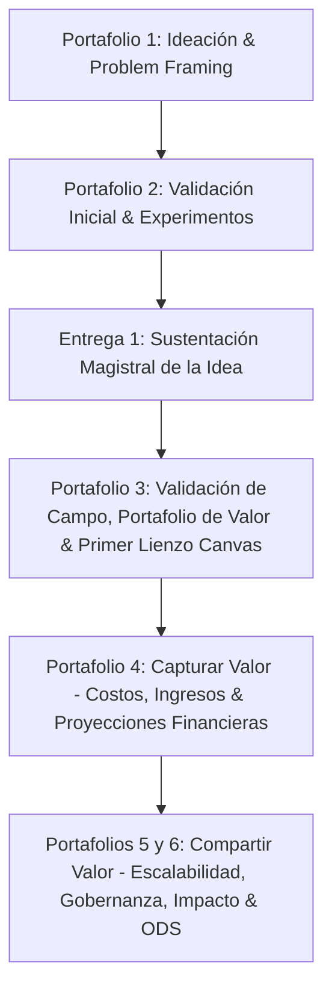

# Guía Maestra de Navegación, Estándar y Trazabilidad Oficial del Proyecto
## Repositorio General de Emprendimiento — Pregrado en Ciencia de Datos
**Curso:** Emprendimiento (Pregrado en Ciencia de Datos)  
**Institución:** Universidad Externado de Colombia — Semestre 2026-II  
**Grupo 5:** Santiago Sandoval, Sebastián Ramos, Julián Duarte, Tomás Rincón, Julián Jiménez  

> [!NOTE]
> **Hito de Pivote Estratégico (Semestre 2026-II):**  
> Durante el corte de evaluación posterior al Portafolio 3, el equipo identificó barreras de acceso a tomadores de decisión bancarios en el proyecto inicial *StatCredit AI*. Siguiendo la metodología de Lean Startup y Steve Blank (2021), el equipo ejecutó un pivote hacia **"Wheels Externado"**, una plataforma inteligente de viajes compartidos (carpooling) con verificación institucional obligatoria para la comunidad de la Universidad Externado de Colombia. Los entregables previos (Portafolios 1 al 3 y Entrega 1) quedan archivados y preservados como soporte de la etapa 1, mientras que los entregables actuales (**Entrega 3** y **Portafolio de Evidencias 4**) se desarrollan sobre la solución de movilidad.

---

## 📌 1. Propósito de esta Guía Maestra
Este documento es la **fuente única de verdad (Single Source of Truth)** para el desarrollo estratégico, metodológico y documental de **StatCredit AI**.
Su objetivo es garantizar la **estricta linealidad histórica**, el cumplimiento del estándar de redacción docente y la coherencia visual y técnica en todas las entregas académicas, facilitando que cualquier integrante del equipo o asistente de inteligencia artificial pueda retomar el proyecto conociendo exactamente qué se ha hecho, qué correcciones se aplicaron y qué sigue.

---

## 🚀 2. Identidad del Proyecto

- **Nombre:** StatCredit AI
- **Definición:** Plataforma analítica en modelo **Software as a Service (SaaS B2B)** orientada a entidades financieras, neobancos y cooperativas de crédito en Colombia. Transforma datos transaccionales de bajo monto (Nequi, Daviplata, facturación electrónica) en métricas objetivas de riesgo crediticio y capacidad real de repago para trabajadores independientes solventes y micronegocios, mediante modelos de Machine Learning con **Inteligencia Artificial Explicable (XAI / SHAP)** que cumplen rigurosamente la normativa **SARC (Circular Externa 026 de 2022 de la Superintendencia Financiera de Colombia)**.
- **Enunciado Insignia del Proyecto:**
  > *"No buscamos cambiar quién puede acceder al crédito; buscamos cambiar la forma en que se mide quién puede pagarlo."*

### Equipo de Trabajo (Grupo 5)
| Nombre | Rol Principal | Enfoque Técnico y Estratégico |
| :--- | :--- | :--- |
| **Santiago Sandoval** | Data Science Lead / ML Architect | Algoritmos de scoring, inferencia causal, explicabilidad SHAP y MLOps. |
| **Sebastián Ramos** | Director de Estrategia & Negocios B2B | Modelo de monetización SaaS, unit economics (LTV/CAC) y TAM/SAM/SOM. |
| **Julián Duarte** | Data Engineer / Backend Architect | Ingesta transaccional, pipelines de extracción y arquitectura REST API. |
| **Tomás Rincón** | Analista de Riesgo & Compliance SARC | Regulación financiera, normatividad SARC de la SFC y auditoría algorítmica. |
| **Julián Jiménez** | Software Engineer / QA | Integración de módulos, calidad de código y pruebas de latencia (<2s). |

---

## 📈 3. Trazabilidad y Linealidad Histórica del Proyecto



### **Hito 1: Portafolio de Evidencias No. 1 — Ideación y Problem Framing**
- **Foco:** Planteamiento inicial del dolor, Ikigai del equipo, contrato de equipo (*Term Sheet*).
- **Hitos Clave:**
  - Identificación de la asimetría de información en el sistema crediticio tradicional para independientes.
  - Primer reencuadre bajo el marco de **Bianchi & Verganti (2021)**: el problema no es que los independientes sean mala paga, sino que la banca carece de herramientas para medir su flujo de caja real.
- **Ubicación:** `02_Portafolios_de_Evidencias/Portafolio_1/`

### **Hito 2: Portafolio de Evidencias No. 2 — Validación Inicial y Matriz de Experimentos**
- **Foco:** Diseño de matriz de experimentación y primeras validaciones con actores del sector.
- **Hitos Clave:**
  - Tarea 1: Validación cualitativa temprana sobre barreras en burós de crédito (`Entrevistas_expertos.pdf`).
  - Tarea 2: Matriz formal de hipótesis críticas y métodos de prueba.
  - Tarea 3: Primer esquema preliminar del modelo de negocio.
- **Ubicación:** `02_Portafolios_de_Evidencias/Portafolio_2/`

### **Hito 3: Entrega 1 — Sustentación y Prototipo Temprano**
- **Foco:** Presentación magistral de la idea ante la clase y sustentación de la oportunidad de mercado.
- **Insumos:** Diapositivas oficiales, documento TeX de soporte y glosario terminológico.
- **Ubicación:** `01_Proyecto_StatCredit_AI/`

### **Hito 4: Portafolio de Evidencias No. 3 — Validación de Campo, Portafolio de Valor y Primer Lienzo Canvas (Estado Actual: Completado)**
- **Foco:** Profundización cuantitativa y cualitativa según las indicaciones de la **Sesión 10 (2 de octubre de 2026)**.
- **Hitos Clave Desarrollados y Aprobados:**
  1. **Evidencias de Campo con Expertos:** Entrevistas en profundidad transcritas a **Diego Ramos** (Riesgo de Consumo) y **Paola Cárdenas** (Regulación SARC).
  2. **Segmentación Rigurosa (Bill Aulet):**
     - Cliente B2B (bancos pequeños/cooperativas) vs. Beneficiario B2B2C (4,5M independientes).
     - Persona: «Don Carlos» (52 años, víveres en Corabastos, flujo en Nequi, sin nómina).
     - Dimensionamiento: TAM = \$36M USD, SAM = \$9M USD, SOM = \$1,08M USD.
     - 10 Primeros Clientes identificados (Lulo, Ualá, Finandina, Contactar, Coofisam, etc.).
     - 10 preguntas de validación directa desde Ciencia de Datos.
  3. **Portafolio de Valor Multidimensional + MVP:**
     - 4 dimensiones: Core Business (scoring explicable en $<2$s), Profit (+20% colocación, -70% costo análisis), People (inclusión formal vs. gota a gota) y Planet (cero papel, cloud).
     - Evidencia fotográfica y transcripción del taller creativo de post-its del 2 de octubre (`trabajo_clase_2_octubre_2026.png`).
     - MVP pipeline en 4 pasos (Ingesta $\rightarrow$ Feature Engineering $\rightarrow$ Scoring $\rightarrow$ XAI/SHAP).
  4. **Canales y Flujo de Ventas (Aulet Paso 18):** Estrategia a Corto Plazo (Field Sales + PoC 30 días), Mediano Plazo (Colombia Fintech) y Largo Plazo (APIs abiertas); modelo de retención con SLA 99,9% y actualización continua SARC.
  5. **Fuentes de Ingreso y Economía (Aulet Cap 15):** SaaS recurrente (\$1.500 USD/mes) + pay-per-query (\$0,80 a \$0,50 USD). Unit economics: CAC = \$4.000 USD, LTV = \$60.000 USD, ratio **LTV/CAC $>15\times$**.
  6. **Primer Lienzo Canvas (Zona ENTREGAR: P1 a P3):** Cuadro de mando ejecutivo formalizado en tarjetas visuales `tcolorbox`, articulando Problema (B1), Actores (B2), Portafolio de Valor (B3) y Canales/Relación (B7).
- **Archivos Oficiales:**
  - Documento fuente: `02_Portafolios_de_Evidencias/Portafolio_3/Portafolio_de_Evidencias_3_StatCredit_AI.tex`
  - Documento compilado: `02_Portafolios_de_Evidencias/Portafolio_3/Portafolio_de_Evidencias_3_StatCredit_AI.pdf`
  - Evidencia gráfica: `02_Portafolios_de_Evidencias/Portafolio_3/trabajo_clase_2_octubre_2026.png`

### **Hitos Futuros (Ruta de Trabajo)**
- **Portafolio 4 (Capturar Valor):** Estructura detallada de costos operativos (infraestructura cloud, salarios de ingenieros, auditorías de seguridad) y modelación de ingresos a 3 y 5 años (Punto de Equilibrio).
- **Portafolios 5 y 6 (Compartir Valor):** Gobernanza corporativa, métricas de impacto social (reducción de dependencia de usura informal), alineación con Objetivos de Desarrollo Sostenible (ODS 1: Fin de la pobreza, ODS 8: Trabajo decente y crecimiento económico, ODS 10: Reducción de desigualdades) y estrategia de licenciamiento/escalabilidad regional.

---

## 🎯 4. Reglas de Oro Narrativas y de Posicionamiento (Feedback Oficial)

Documentado a partir de la guía oficial `Complementacion.pdf` y las correcciones de la docente:

### ❌ Lo que NUNCA debemos decir (Prohibiciones Narrativas)
- **NUNCA** decir: *"Los bancos tradicionales están ciegos / obsoletos / no quieren prestarles"*.
- **NUNCA** decir: *"Nosotros venimos a enseñarle a la banca cómo hacer su trabajo"*.
- **NUNCA** asegurar: *"Eliminamos el 100% del riesgo o de los sesgos crediticios"*.
- **NUNCA** presentar afirmaciones sin sustento de datos reales o estimaciones fundamentadas.

### ✅ La Narrativa Aprobada y Obligatoria
- **Complementariedad B2B:** StatCredit AI es un aliado tecnológico y analítico para la banca, no un competidor ni un crítico destructivo.
- **Dolor Operativo Real:** La banca sí desea atender a los independientes, pero la revisión manual de extractos bancarios es un cuello de botella operacional inviable económicamente para créditos de bajo monto.
- **Rigor SARC:** La exigencia regulatoria de la Superintendencia Financiera impide a los bancos usar «cajas negras». StatCredit AI resuelve esta limitante aportando explicabilidad matemática certificable (SHAP).

---

## 🎨 5. Estándar de Formato LaTeX y Diseño Visual

1. **Paleta de Color Institucional:**
   - `primary`: Azul Marino Profundo `RGB(15, 32, 67)` $\rightarrow$ Encabezados, títulos y marcos principales.
   - `secondary`: Azul Eléctrico `RGB(0, 114, 206)` $\rightarrow$ Enlaces, subtítulos y llamados de atención.
   - `lightgray`: Gris Suave `RGB(245, 247, 250)` $\rightarrow$ Fondos de tarjetas y contenedores de lectura.
2. **Componentes Visuales:**
   - Toda información estructurada o destacada debe usar entornos `\begin{tcolorbox}[arc=2mm,colback=...,colframe=...]`.
   - **PROHIBIDO:** Usar tablas toscas con bordes negros rígidos (`|X|X|`) y comandos `\rowcolor` que puedan fallar en la compilación. El lienzo Canvas se presenta en tarjetas ejecutivas `tcolorbox` en minipages equilibradas.
3. **Manejo de Caracteres en Español:**
   - Mantener siempre `\usepackage[spanish,es-noquoting]{babel}` y caracteres con escape estándar de LaTeX (`\'a, \'e, \'i, \'o, \'u, \~n, \textquestiondown`) para garantizar total portabilidad entre Overleaf, MiKTeX, TeX Live y plataformas cloud.
4. **Higiene del Repositorio:**
   - Nunca dejar archivos temporales de compilación (`.aux`, `.log`, `.out`, `.toc`, `.synctex.gz`) ni archivos de flujo NTFS (`Zone.Identifier`) en las carpetas del repositorio.

---

## 🗂️ 6. Directorio Maestro del Repositorio

```
Emprendimiento/
├── README.md                                      # Cuadro de Mando Principal del Repositorio
│
├── 00_Estandar_y_Metodologia/                     # Normativas, Feedback y Guías Máster
│   ├── 00_Guia_Maestra_y_Estandar_del_Proyecto.md # (ESTE DOCUMENTO) Línea base del proyecto
│   └── 00_Estandar_Redaccion_y_Metodologia.md     # Manual de estilo narrativo y Bianchi & Verganti
│
├── 01_Proyecto_StatCredit_AI/                     # Desarrollo Estratégico Inicial
│   ├── 01_Talleres_y_Contratos/                   # Talleres presenciales, Ikigai, Term Sheet
│   └── 02_Presentaciones_y_Diapositivas/          # PPTX, HTML y Glosarios de sustentación
│
├── 02_Portafolios_de_Evidencias/                  # Entregables Oficiales Evaluables
│   ├── Portafolio_1/                              # Respaldo y enlaces a Notion
│   │   └── README.md
│   ├── Portafolio_2/                              # Tareas 1, 2 y 3 de validación inicial
│   │   ├── Portafolio_de_Evidencias_2_StatCredit_AI.tex
│   │   ├── Entrevistas_expertos.pdf
│   │   └── README.md
│   └── Portafolio_3/                              # ENTREGA ACTUAL: Validación de Campo y Canvas
│       ├── Portafolio_de_Evidencias_3_StatCredit_AI.tex
│       ├── Portafolio_de_Evidencias_3_StatCredit_AI.pdf
│       ├── trabajo_clase_2_octubre_2026.png
│       └── README.md
│
├── 03_Materiales_de_Clase/                        # Presentaciones magistrales y circulares
│   └── README.md                                  # Mapeo de diapositivas por sesión
│
└── 04_Lecturas_y_Bibliografia/                   # Artículos científicos fundacionales
    ├── 2021_A path towards a MVP_Steve blank.pdf
    ├── JBVD_2021_Bianchi, Roberto Verganti_Entrepreneurs as designers of problems worth solving.pdf
    └── README.md                                  # Resumen académico y aportes al proyecto
```
