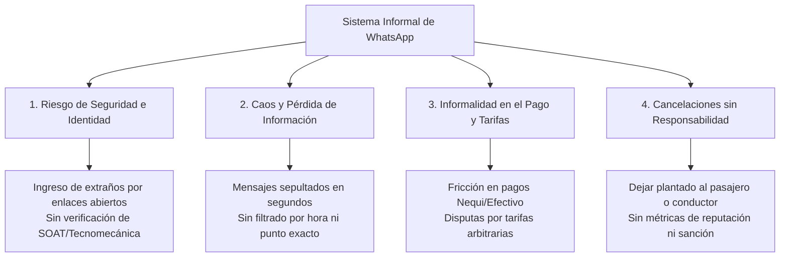

# Ficha Técnica del Problema y Justificación del Pivote
## De StatCredit AI a Plataforma de Movilidad Universitaria ("Wheels Externado")
**Universidad Externado de Colombia — Pregrado en Ciencia de Datos**  
**Grupo 5**

---

## 1. El Diagnóstico del Dolor: La Realidad de la Movilidad en el Externado

### 1.1 Contexto Geográfico y Logístico Único
La Universidad Externado de Colombia presenta una condición topográfica y urbana particular:
- Ubicada en la ladera oriental de los Cerros de Bogotá (La Candelaria / barrio Egipto).
- Las vías de acceso vehicular son estrechas (Carrera 1 Este, Calle 12), con congestión extrema en horas pico de entrada (6:30 a 8:00 AM) y salida (4:30 a 7:30 PM).
- Para los peatones que llegan por TransMilenio (Estaciones Las Aguas y Universidades) o Carrera Décima/Séptima, la caminata en pendiente es empinada y, en horarios nocturnos, presenta alta percepción de inseguridad.

### 1.2 El Sistema Informal Actual: Grupos de WhatsApp
Frente a estas dificultades, los estudiantes han organizado de manera espontánea e informal grupos de WhatsApp para compartir vehículos ("hacer Wheels"):
- Existen más de 15 grupos segmentados de forma rústica: *"Wheels Externado Norte"*, *"Wheels Chía/Cajicá"*, *"Wheels Suba"*, *"Wheels Calle 80"*, *"Wheels Boyacá/Salitre"*, *"Wheels Sur/Soacha"*.
- Estos grupos tienen entre 300 y 1.000 participantes cada uno.

### 1.3 Los Cuatro Dolores Críticos del Sistema de WhatsApp

1. **Riesgo Crítico de Seguridad e Identidad:**
   - Cualquier persona puede unirse mediante links compartidos en redes.
   - No se valida si el conductor o el pasajero es realmente miembro activo de la universidad.
   - Cero control sobre el estado de la licencia de conducción, vigencia de SOAT o revisión técnico-mecánica del vehículo.
2. **Caos en la Comunicación y Pérdida de Oportunidades:**
   - En horas pico se envían decenas de mensajes por minuto.
   - Un conductor que publica *"Salgo a las 2pm por la 100"* queda tapado en el chat en menos de 30 segundos.
   - Pasajeros y conductores no logran coordinar puntos de encuentro precisos ni itinerarios.
3. **Incertidumbre y Cancelaciones:**
   - No existe compromiso formal. Pasajeros confirman y luego no aparecen, o conductores deciden salir antes dejando a compañeros sin alternativa de transporte.
   - No hay historial, perfil ni calificación de confiabilidad.
4. **Fricción en Tarifas y Pagos:**
   - No hay un tarifario justo ni estandarizado según la distancia.
   - Problemas recurrentes con pagos en efectivo sin cambio o demoras en transferencias de Nequi/Daviplata.

---

## 2. La Oportunidad y Reencuadre del Problema (Bianchi & Verganti)

- **El problema visible:** "Faltan opciones de transporte para subir y bajar del Externado".
- **El reencuadre de sentido:** El problema no es que no haya vehículos subiendo y bajando; miles de carros particulares de la comunidad entran y salen diariamente con 3 o 4 puestos vacíos. **El verdadero problema es la ausencia de un canal estructurado, seguro y confiable que conecte oferta y demanda con trazabilidad institucional.**

---

## 3. Matriz de Stakeholders en el Externado

| Actor | Interés / Necesidad Principal | Dolor con WhatsApp | Ganancia con la App |
| :--- | :--- | :--- | :--- |
| **Estudiante Conductor** | Subsidiar los altos costos de gasolina, parqueadero y peajes. | Publicar repetitivamente, lidiar con cobros y pasajeros impuntuales. | Rutas predecibles, pasajeros confirmados y pago garantizado. |
| **Estudiante Pasajero** | Llegar cómodo, seguro y a tiempo a clase pagando menos que un Uber/taxi. | Mensajes ignorados, inseguridad al subir a carros desconocidos, plantones. | Reserva garantizada, conductor verificado y trazabilidad en ruta. |
| **Universidad Externado** | Mitigar el colapso vial en los Cerros, fomentar la sostenibilidad y seguridad estudiantil. | Sin visibilidad ni control de los incidentes que ocurren en los grupos informales. | Datos de movilidad, fomento de comunidad y reducción de huella de carbono. |

