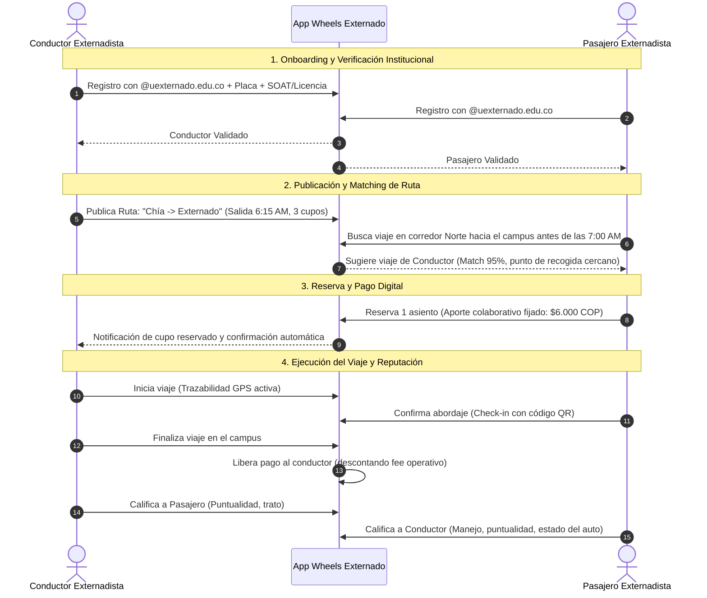

# Arquitectura Conceptual y Especificación del Prototipo
## App de Carpooling Institucional ("Wheels Externado")
**Universidad Externado de Colombia — Pregrado en Ciencia de Datos**

---

## 1. Arquitectura en 4 Pasos Funcionales

---

## 2. Componentes Técnicos Clave

### 2.1 Módulo de Seguridad y Confianza
- **Filtro Institucional Obligatorio:** Integración con OAuth / Microsoft 365 de la Universidad Externado (`@uexternado.edu.co`).
- **Verificación de Vehículos:** Consulta automatizada contra el RUNT para validar vigencia de SOAT y revisión técnico-mecánica.
- **Botón SOS / Compartir Viaje:** Opción para compartir el enlace del trayecto en tiempo real con contactos de confianza.

### 2.2 Algoritmo de Matching Geoespacial
- Indexación espacial de rutas sobre los principales corredores de Bogotá (Autopista Norte, Av. Boyacá, Av. Suba, Carrera 30 / NQS, Calle 26, Calle 80, Circunvalar).
- Ventanas de tolerancia temporal ajustadas al horario de clases del Externado (márgenes de 10-15 minutos).

### 2.3 Modelo de Pagos Colaborativos
- No es una tarifa de servicio comercial (evitando problemas regulatorios de transporte no autorizado).
- Es una **cuota colaborativa de compensación de gastos** (combustible, desgaste, peajes y parqueadero).
- Tarifas sugeridas transparentes basadas en zonas geográficas.

