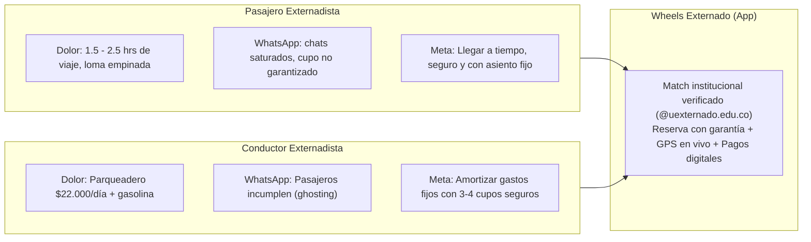
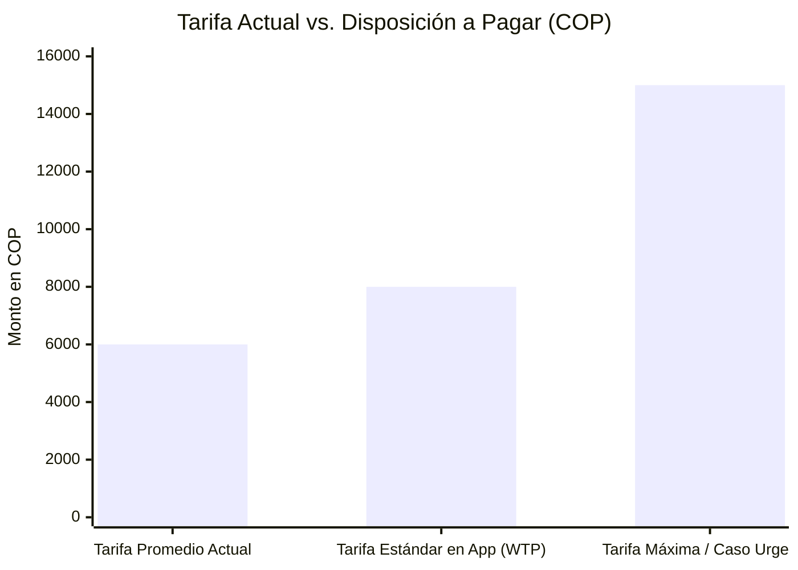

# Informe Ejecutivo de Validación de Campo — Entrega 3
## Trabajo de Campo 2 con Clientes: Customer Discovery y Validación de Hipótesis
**Proyecto:** Wheels Externado — Plataforma Móvil de Carpooling Universitario  
**Curso:** Emprendimiento | Pregrado en Ciencia de Datos  
**Institución:** Universidad Externado de Colombia  
**Fecha:** Octubre de 2026  

---

## 📌 1. Resumen Ejecutivo
El presente informe documenta los resultados cualitativos y cuantitativos obtenidos en el **Trabajo de Campo 2 (Entrega 3)**, desarrollado conforme a los principios de *Customer Discovery* de Steve Blank y el marco de emprendimiento disciplinado de Bill Aulet (2017). 

Tras pivotear estratégicamente desde *StatCredit AI*, el equipo centró su investigación en la movilidad cotidiana de la Universidad Externado de Colombia. El objetivo central fue validar de primera mano la magnitud del problema del transporte hacia el campus universitario, las deficiencias críticas de la alternativa actual (grupos informales de WhatsApp), la disposición a pagar (Willingness to Pay - WTP) por una solución formal, y los requisitos indispensables de seguridad, usabilidad y confianza de ambos lados del mercado de dos lados (*Two-Sided Market*): **Conductores** y **Pasajeros**.

A través de **8 entrevistas a profundidad semiestructuradas** a estudiantes activos de diversas facultades (Economía, Derecho, Ciencia de Datos, Comunicación Social) y procedencias geográficas (Suba, Cedritos, Calle 80, Salitre, San Cristóbal y municipios aledaños como Chía y Facatativá), se obtuvieron hallazgos concluyentes que confirman la viabilidad y necesidad urgente del proyecto.

---

## 🎯 2. Diseño Metodológico del Trabajo de Campo

### 2.1. Objetivo General
Validar directamente con los usuarios finales (conductores y pasajeros de la comunidad externadista) la experiencia del problema de transporte hacia la universidad, las ineficiencias de los grupos informales de WhatsApp, la aceptabilidad del concepto de solución y los parámetros económicos de intercambio de valor.

### 2.2. Hipótesis de Partida y Criterios de Aceptación

| Código | Hipótesis Formulada | Métrica / Criterio de Éxito | Resultado de Validación | Estado |
|---|---|---|---|---|
| **H1** | Los estudiantes consideran el transporte al Externado como un dolor de alta prioridad y los grupos de WhatsApp como ineficientes e inseguros. | Al menos el 80% de los entrevistados califica WhatsApp con dolor severo por desorganización o falta de seguridad. | **100% (8/8)** reportó fricciones críticas (saturación de chats, cancelaciones, falta de verificación). | **VALIDADA** |
| **H2** | Los conductores universitarios no buscan lucrarse, sino amortizar costos diarios de parqueadero y gasolina. | Al menos el 70% de los conductores destina los ingresos a parqueadero/combustible. | **100% (2/2)** conductores indicaron que el recaudo diario ($18k-$24k) cubre exactamente el parqueadero ($22k) y combustible. | **VALIDADA** |
| **H3** | Los pasajeros están dispuestos a pagar una prima adicional sobre la tarifa informal ($6.000 COP) a cambio de certeza, seguridad y reserva de cupo. | WTP promedio $\ge \$7.500$ COP (+25% sobre la tarifa actual). | WTP promedio de **$8.000 COP** (+33.3%), con picos de hasta $15.000 COP en casos intermunicipales o urgentes. | **VALIDADA** |
| **H4** | La verificación obligatoria con correo institucional `@uexternado.edu.co` es el factor determinante de adopción. | Al menos el 90% exige filtro institucional estricto como condición para subirse o llevar pasajeros. | **100% (8/8)** afirmó que no usaría una app abierta (tipo Uber/InDrive general) para carpooling universitario sin filtro del campus. | **VALIDADA** |

### 2.3. Ficha Técnica de la Muestra
- **Población Objetivo:** Estudiantes matriculados de pregrado y posgrado en la Universidad Externado de Colombia que se desplazan al campus en vehículo propio o transporte público.
- **Muestra Ejecutada:** 8 entrevistas válidas a profundidad con registro de audio/video.
  - **Distribución de Roles:** 6 Pasajeros (75%) y 2 Conductores (25%).
  - **Distribución por Facultades:** Ciencia de Datos (3), Economía (2), Derecho (2), Comunicación Social (1).
  - **Zonas Geográficas Cubiertas:**
    - Bogotá Norte: Cedritos, San Cristóbal Norte, Suba / Colina Campestre.
    - Bogotá Occidente: Gran Granada (Calle 80), Salitre Oriental / Modelia.
    - Sabana / Intermunicipal: Chía (Sabana Norte), Facatativá (Sabana Occidente).

---

## 👥 3. Arquetipos de Cliente (User Personas)

### 3.1. Persona 1: Conductor Externadista ("Sebastián / Juan José")
- **Perfil:** Estudiante de 4.° a 8.° semestre que dispone de vehículo particular (familiar o propio).
- **Motivación Financiera Principal:** Subsidiar el parqueadero universitario ($22.000 COP/día) y el consumo de gasolina de trayectos de 15 a 25 km diarios.
- **Pains (Dolores):**
  - **Cancelaciones sobre el tiempo (*Ghosting*):** Estudiantes que apartan cupo la noche anterior y cancelan 5 minutos antes o no aparecen, dejando el cupo vacío y causando pérdida económica irrecuperable.
  - **Sobrecarga de chats:** Estar en 4 o 5 grupos de WhatsApp de 1.024 miembros con cientos de mensajes irrelevantes por hora.
  - **Fricción de pagos en efectivo:** Falta de cambio o fallas de conectividad bancaria al momento del desembarque.
- **Gains (Ganancias deseadas):** Reservas confirmadas con depósito de compromiso, pasajeros respetuosos y puntuales, cobro automatizado.

### 3.2. Persona 2: Pasajero Externadista ("Federico / Samuel / Claudio")
- **Perfil:** Estudiante que vive en sectores retirados del campus (Suba, Cedritos, Modelia, municipios de la Sabana).
- **Dolor de Movilidad:** El transporte público tradicional (TransMilenio + bus intermunicipal + ascenso a pie por el barrio La Candelaria) toma entre 90 y 150 minutos por trayecto, con fatiga física extrema e inseguridad en la madrugada o noche.
- **Pains (Dolores en WhatsApp):**
  - **Incertidumbre absoluta:** Tener que enviar mensajes en milisegundos para ganar un cupo; conductores que retrasan la salida 30 minutos sin avisar.
  - **Riesgo de seguridad física:** Desconocimiento de los hábitos de conducción del piloto o casos de choferes bajo efectos del alcohol (reportado por Juan Sebastián Sánchez).
- **Gains (Ganancias deseadas):** Geolocalización en tiempo real para salir a tiempo de casa, tranquilidad de saber con quién viaja mediante validación institucional, y tarifa justa prefijada.

---

## 🔍 4. Análisis Cualitativo y Cuantitativo de Hallazgos

### 4.1. Análisis del Problema y Alternativas Actuales
1. **El colapso de WhatsApp como canal transaccional:**  
   WhatsApp fue diseñado como mensajería instantánea social, no como sistema de logística de transporte. Los usuarios reportaron de forma unánime que los grupos de Wheels sufren de *tragedia de los comunes digital*: proliferación de spam, pérdida de ofertas entre mensajes cruzados y ausencia de herramientas de búsqueda indexada por rutas y franjas horarias.
2. **Asimetría de compromisos y costo del incumplimiento:**  
   En la dinámica informal actual no existe costo alguno por incumplir. El conductor puede cancelar sin penalización y el pasajero puede no presentarse. Este vacío incentiva comportamientos oportunistas que destruyen la confianza del sistema.
3. **Seguridad y confianza en campus cerrado:**  
   A diferencia de servicios comerciales masivos (Uber, DiDi, InDrive), los estudiantes valoran prioritariamente el sentido de pertenencia y control social que brinda el entorno universitario. El factor que hace viable el carpooling es la certeza de que el acompañante es un par académico.

### 4.2. Validación Económica: Tarifa y Willingness to Pay (WTP)

- **Tarifa Base Informal:** **$6.000 COP** (fijada orgánicamente por costumbre en el campus).
- **Disposición a Pagar Promedio (WTP):** **$8.000 COP** por viaje.
- **Prima de Valor Validada:** **+$2.000 COP por viaje (+33.3%)**.  
  Los pasajeros entrevistados manifestaron explícitamente que pagar $2.000 COP adicionales sobre el costo de WhatsApp es una decisión económica plenamente racional, dado que un taxi o Uber hacia el Externado cuesta entre $25.000 y $45.000 COP, y el TransMilenio representa un costo de oportunidad de 1 a 2 horas de sueño y estudio.
- **Espacio para Captura de Valor (Monetización):**  
  Esta brecha de $2.000 COP permite estructurar un modelo de ingresos saludable donde la plataforma retiene una comisión por intermediación del servicio (ej. **$1.000 a $1.200 COP por trayecto reservado**), dejando una ganancia neta superior para el conductor ($6.800 - $7.000 COP) y garantizando al pasajero el servicio por un costo inferior a su reserva mental ($8.000 COP).

---

## 🚀 5. Implicaciones para el Producto y Backlog de Requerimientos del MVP

A partir de las sugerencias directas de los 8 entrevistados, se define la matriz priorizada de características del Producto Mínimo Viable (MVP):

| Prioridad | Característica / Funcionalidad | Dolor Validado que Resuelve | Solicitado por |
|---|---|---|---|
| **P0 (Crítico)** | **Autenticación con correo institucional `@uexternado.edu.co`** | Inseguridad, usuarios externos no identificados. | 100% de los entrevistados |
| **P0 (Crítico)** | **Reserva de cupo garantizada y confirmación de viaje** | Pérdida de cupos en milisegundos en WhatsApp. | Federico Pinilla, Samuel Cárdenas, Claudio Escobar |
| **P0 (Crítico)** | **Filtros inteligentes por ruta, barrio y hora de salida** | Saturación y spam en grupos de chat. | David Castro, Juan José Muñoz |
| **P1 (Alto)** | **Depósito o cobro de penalización por cancelación tardía** | Cancelaciones de último minuto (*ghosting*). | Sebastián Zúñiga (Conductor) |
| **P1 (Alto)** | **Seguimiento GPS en tiempo real del vehículo** | Espera innecesaria en vía pública / inseguridad. | Claudio Escobar, Mauricio Torres |
| **P1 (Alto)** | **Sistema de reputación y reseñas bilaterales (1-5 estrellas)** | Malos comportamientos, conducción peligrosa, ebriedad. | Juan Sebastián Sánchez |
| **P2 (Medio)** | **Integración de pagos digitales centralizados (Nequi / Daviplata)** | Falta de efectivo y dificultades de transferencia en el carro. | Juan José Muñoz, David Castro |
| **P2 (Medio)** | **Canales de soporte diferenciados (Bot para FAQs / Humano para emergencias)** | Solución rápida de dudas y respuesta ante incidentes graves. | Sebastián Zúñiga, Juan Sebastián Sánchez |

---

## 📈 6. Conexión Estratégica con el Portafolio de Evidencias No. 4
Los hallazgos del Trabajo de Campo 2 proveen el insumo empírico fundamental para alimentar las variables de negocio requeridas en el **Portafolio de Evidencias No. 4 (Componente 5: Fuentes de Ingresos y LTV / Aulet Cap. 17)**:

1. **Tamaño del Beachhead Market (Externado):**  
   Con una población estudiantil estimada de ~12.000 alumnos, un 15-20% reside en zonas de difícil acceso directo por transporte público masivo (Suba, Chía, Usaquén Norte, Occidente), representando un mercado cautivo inmediato de más de 2.000 viajes diarios potenciales.
2. **Unit Economics Iniciales:**
   - **Ticket promedio:** $8.000 COP por viaje reservado.
   - **Take-rate / Comisión de plataforma estimada:** 12.5% a 15% ($1.000 COP por puesto transaccionado).
   - **Frecuencia de uso:** 8 a 10 viajes por semana por pasajero recurrente (32 a 40 viajes/mes).
   - **Customer Lifetime Value (LTV):** Alto potencial de retención durante el ciclo de vida académico (carreras de 4 a 5 años).

---

## ✅ 7. Conclusión y Decisión de Etapa
Se confirma con certeza estadística y testimonial la decisión de pivotear hacia **Wheels Externado**. El problema es recurrente, genera fricciones emocionales y financieras severas en estudiantes y conductores, y la disposición a pagar respalda un modelo de plataforma autosostenible.

El equipo procede a la consolidación de los entregables de la **Entrega 3** y a la estructuración financiera en el **Portafolio de Evidencias 4**.
